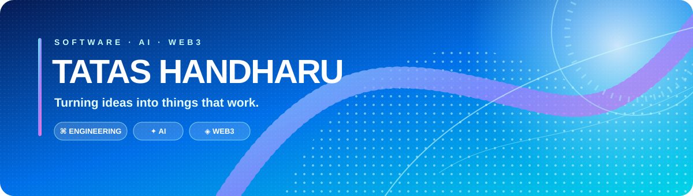

<!-- Tatas Handharu Sworo | Software Engineering & Web3 -->

  
   
  <a href="https://tatashandharu15.github.io">Portfolio</a> ·
  <a href="https://github.com/tatashandharu15">GitHub</a> ·
  <a href="mailto:tatas.handharu@gmail.com">Email</a>

---

## About

I'm an engineer interested in turning complex workflows and data into dependable software. My work spans backend development, AI/LLM applications, monitoring platforms, and blockchain-oriented projects.

- **Software Engineering** — backend services, API design, integrations, and maintainable applications.
- **AI Systems** — LLM integrations, AI-assisted workflows, and applied machine learning.
- **Web3 & Blockchain** — wallet intelligence, blockchain analytics, and on-chain risk concepts.
- **Data & Monitoring** — analytical workflows, forecasting, and operational visibility.

## Selected Work

<table>
<tr><td width="50%" valign="top">

### Web3 & Blockchain

**[Cryptonite Engine](https://github.com/tatashandharu15/cryptonite-engine)**  
Blockchain-focused engineering project.

**[Nexchain](https://github.com/tatashandharu15/nexchain)**  
Web3 project workspace.

</td><td width="50%" valign="top">

### AI & Platform Engineering

**[AI-Assisted Lead Management](https://github.com/tatashandharu15/ai-assisted-lead-management)**  
AI-assisted lead-management workflow.

**[Cyber Threat Intelligence](https://github.com/tatashandharu15/Cyber-Threat-Intelligent)**  
Cybersecurity intelligence project.

</td></tr>
<tr><td valign="top">

### Monitoring

[Brand Monitoring](https://github.com/tatashandharu15/brand_monitoring) · [Project Monitoring](https://github.com/tatashandharu15/project_monitoring)

</td><td valign="top">

### Data & Applied ML

[CV Analytics with LLM](https://github.com/tatashandharu15/CV-Analytics-LLM--using-OpenAI) · [IDX Stock Price Prediction](https://github.com/tatashandharu15/Analysis_and_Prediction_of_Indonesia-Stock-Exchange-IDX-_Stock-Prices)

</td></tr>
</table>

Project descriptions are intentionally brief; each repository's README is the source of truth for implementation details and current status.

## Technical Toolkit

  <strong>Languages</strong> 
  

  <strong>Backend, Frontend & Data</strong> 
  

  <strong>AI, Dev Tools & Infrastructure</strong> 
  

  <strong>Web3</strong> 
  
   
  Blockchain analytics and wallet intelligence are focus areas; icons indicate ecosystem interests, not a claim that every listed tool is used in every project.

## Engineering Principles

- **Maintainability first:** clear boundaries, readable code, and explicit contracts.
- **Test beyond the happy path:** validate edge cases and failure behavior.
- **Security as a baseline:** validate inputs, protect secrets, and review dependencies.
- **Operational clarity:** document configuration, setup, and troubleshooting.
- **Honest delivery:** separate implemented features from experiments and planned work.

## GitHub Activity

  
  
   
  

## Current Direction

- Building reliable backend and AI-powered applications.
- Exploring practical Web3 and blockchain tooling.
- Improving test coverage, documentation, and repeatable engineering workflows.

---

  
   
  <strong>Build useful systems. Make them reliable. Keep learning.</strong>
   
  Jakarta, Indonesia · UTC+7

