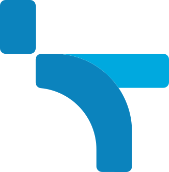

<!-- Tatas Handharu | Software Engineering & Web3 -->

  
   
  <a href="https://tatashandharu15.github.io">Portfolio</a> ·
  <a href="https://github.com/tatashandharu15">GitHub</a> ·
  <a href="mailto:tatas.handharu@gmail.com">Email</a>

---

## 👋 A little about me

I enjoy building software that connects the dots — from backend systems and AI-powered workflows to the possibilities of Web3.

I’m usually curious about **how things work under the hood**: how data moves, how services fit together, how AI can make a workflow smarter, and how to turn an idea into something people can actually use.

Right now, I’m exploring the space where **software engineering × AI × blockchain** meet. This profile is my workshop: experiments, projects, and things I’m learning along the way.

## 🚀 Things on my workbench

<table>
<tr>
<td width="50%" valign="top">

<h3>⛓️ Cryptonite Engine</h3>

A project exploring blockchain-focused engineering and tooling.

</td>
<td width="50%" valign="top">

<h3>🌐 Nexchain</h3>

A Web3 project space for exploring blockchain ideas and implementation.

</td>
</tr>
<tr>
<td width="50%" valign="top">

<h3>🧠 AI-Assisted Lead Management</h3>

An application focused on bringing AI assistance into a lead-management workflow.

</td>
<td width="50%" valign="top">

<h3>🔎 CV Analytics with LLM</h3>

An experiment with using large language models for CV-related analysis.

</td>
</tr>
<tr>
<td width="50%" valign="top">

<h3>🛡️ Cyber Threat Intelligence</h3>

A project in the cybersecurity intelligence space.

</td>
<td width="50%" valign="top">

<h3>📊 Data & Monitoring Projects</h3>

A collection spanning stock-price prediction, brand monitoring, and project monitoring.

</td>
</tr>
</table>

## 🧰 Technical Toolkit

### 💻 Languages

### 🏗️ Software Engineering

### 🗄️ Databases & Data Access

### 🧠 AI, LLM & Machine Learning

### ☁️ DevOps, Cloud & Observability

### ⛓️ Web3 & Blockchain

### 📊 Data Science, BI & Automation

<table>
<tr>
<td width="50%" valign="top">

### 🧩 Software Engineering & Architecture

- Backend and platform engineering
- REST API design and service integrations
- Authentication and session management (JWT)
- Database modeling, migrations, and ORM workflows
- Modular application architecture and domain-based services
- Testing, debugging, code review, and maintainability
- Real-time integrations with WebSockets
- CI/CD and repeatable deployment workflows

</td>
<td width="50%" valign="top">

### 🤖 AI & LLM Engineering

- OpenAI API and Google Gemini
- LangChain and Hugging Face
- Retrieval-Augmented Generation (RAG)
- AI agents, tool integrations, and structured outputs
- Prompt engineering and LLM application integration
- Applied NLP and document intelligence
- AI workflow automation and monitoring

</td>
</tr>
<tr>
<td width="50%" valign="top">

### 📈 Data Science & Analytics

- pandas, NumPy, scikit-learn
- Data cleaning and feature engineering
- Model evaluation and experimentation
- Time-series analysis and forecasting
- ETL pipelines and data visualization
- Tableau, Looker Studio, and Power BI
- Google Analytics 4 and measurement workflows

</td>
<td width="50%" valign="top">

### ⛓️ Web3 & Cyber Intelligence

- **Languages:** Solidity for smart contracts; Go, TypeScript, and Python for blockchain-connected services and applications
- **EVM ecosystem:** Ethereum, EVM-compatible networks, and testnets
- **Smart contracts:** Foundry workflows and OpenZeppelin libraries
- **Application integration:** Web3.py, wagmi, and viem
- **On-chain data:** wallet intelligence, RPC integration, transaction analysis, and risk-analysis concepts
- Cyber threat intelligence and OSINT-oriented workflows
- Monitoring, alerting, and operational dashboards

</td>
</tr>
</table>

Icons use Skill Icons and Shields.io. Technologies reflect areas represented across engineering, AI, data, monitoring, and Web3 work; individual repositories show the actual implementation and current project status.

## Engineering Principles

- **Maintainability first:** clear boundaries, readable code, and explicit contracts.
- **Test beyond the happy path:** validate edge cases and failure behavior.
- **Security as a baseline:** validate inputs, protect secrets, and review dependencies.
- **Operational clarity:** document configuration, setup, and troubleshooting.
- **Honest delivery:** separate implemented features from experiments and planned work.

## GitHub Activity

  
  
   
  

## Current Direction

- Building reliable backend and AI-powered applications.
- Exploring practical Web3 and blockchain tooling.
- Improving test coverage, documentation, and repeatable engineering workflows.

---

  
   
  <strong>Build useful systems. Make them reliable. Keep learning.</strong>
   
  Jakarta, Indonesia · UTC+7

